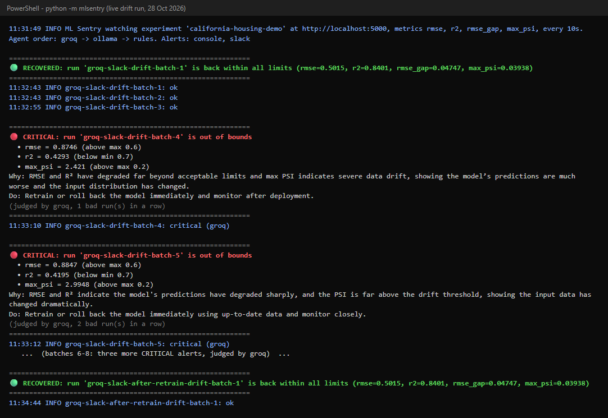

# ML Sentry

**An open-source, model-agnostic agentic governance layer for machine learning models in production.**

ML Sentry runs in Docker next to a model that is already live. It reads the model's evaluation metrics from
your own MLflow, keeps their history, and when a metric goes out of bounds an LLM agent judges how serious it is
and alerts you on Slack or Telegram. After you retrain, it checks again and tells you whether the problem is fixed.

Your model is never uploaded, moved or even loaded: ML Sentry only reads numbers, so it works with any model,
classifier or regressor, in any framework.

```
your model ──logs metrics──> your MLflow <──reads (HTTP)── ML Sentry (Docker)
                                                              │
                                    SQLite history ◄──────────┤
                                    limits from .env ─────────┤ check
                                                              ▼
                                         LangGraph agent: gather → judge → write
                                         (Groq → local Ollama → built-in rules)
                                                              ▼
                                               Slack / Telegram / console alert
```

## Contents

- [How it works](#how-it-works)
- [What it checks](#what-it-checks)
- [What an alert looks like](#what-an-alert-looks-like)
- [What you need](#what-you-need)
- [Quick start](#quick-start)
- [Connect your own model](#connect-your-own-model)
- [Try the demo](#try-the-demo)
- [Common problems](#common-problems)
- [Documentation](#documentation)
- [Repository layout](#repository-layout)

## How it works

1. **Your model logs its results.** Each time you evaluate your model, it logs metrics (RMSE, accuracy, drift, ...)
   to MLflow as one run. This is the only thing your model has to do.
2. **ML Sentry checks for new runs** every few seconds (`POLL_INTERVAL_SECONDS`) and saves them in a small SQLite database.
3. **Each metric is compared with its limit** from `.env`: `<NAME>_MAX` for "lower is better" metrics,
   `<NAME>_MIN` for "higher is better" ones.
4. **If something is out of bounds,** the LangGraph agent decides how serious it is, explains why in plain language
   and suggests what to do. The alert goes to Slack, Telegram and/or the console.
5. **After you retrain,** ML Sentry checks the new results: a **RECOVERED** message if they are back within limits,
   another alert if not.

## What it checks

Whatever metrics your model logs, each with a `_MAX` and/or `_MIN` limit in `.env`. The included demo watches:

- **performance decay**: prediction error (RMSE) and R²
- **data drift**: Population Stability Index (PSI) of the input features
- **bias**: the error gap between two groups (coastal vs inland districts)

Severity is **minor**, **moderate** or **critical**; a problem that lasts 3 evaluations in a row is raised one level.

| Severity | When (built-in rules) | Example |
|---|---|---|
| 🟡 Minor | the worst metric is less than 25% past its limit | RMSE 0.65 with a limit of 0.60 |
| 🟠 Moderate | 25% to 100% past its limit | RMSE 0.90 with a limit of 0.60 |
| 🔴 Critical | more than double the allowed distance | PSI 2.4 with a limit of 0.20 |
| 🟢 Recovered | every metric is back within its limit after a problem | after retraining |

When an LLM is available it makes the final call, using these rules as a guide.

## What an alert looks like

```
🔴 CRITICAL: run 'groq-slack-drift-batch-4' is out of bounds
  • rmse = 0.8746 (above max 0.6)
  • r2 = 0.4293 (below min 0.7)
  • max_psi = 2.421 (above max 0.2)
Why: RMSE and R² have degraded far beyond acceptable limits and max PSI indicates severe data drift,
showing the model's predictions are much worse and the input distribution has changed.
Do: Retrain or roll back the model immediately and monitor after deployment.
(judged by groq, 1 bad run(s) in a row)
```

The same text is sent to Slack or Telegram. Here is a live run with drift, then recovery after retraining:



## What you need

| Need | Required? | Why |
|---|---|---|
| [Docker Desktop](https://www.docker.com/products/docker-desktop/) | Yes | ML Sentry runs as a container |
| An MLflow server your model logs metrics to | Yes | ML Sentry reads the metrics from there |
| A [Groq](https://console.groq.com) API key (free) | Optional | the agent's main LLM |
| [Ollama](https://ollama.com) with a model pulled, e.g. `llama3.1:8b` | Optional | local fallback LLM, works offline |
| A Slack incoming webhook or a Telegram bot | Optional | where alerts are sent |

With no LLM, built-in rules decide the severity. With no Slack or Telegram, alerts are printed to the console.
You always get an alert.

## Quick start

```bash
git clone https://github.com/Sarthakr1003/ML-sentry-capstone.git
cd ML-sentry-capstone
cp .env.example .env        # then edit .env
docker compose up -d --build
docker compose logs -f
```

Step by step:

1. **Download the code** with `git clone` (above) and open the folder.
2. **Create your settings file:** `cp .env.example .env` (Windows PowerShell: `copy .env.example .env`).
3. **Edit `.env`**. The minimum is:

   ```
   MLFLOW_TRACKING_URI=http://127.0.0.1:5000     # your MLflow
   MLFLOW_EXPERIMENT=my-model                   # the experiment your model logs to
   METRICS=rmse,r2                              # metric names exactly as logged
   RMSE_MAX=0.60                                # alert if rmse goes above 0.60
   R2_MIN=0.70                                  # alert if r2 goes below 0.70
   ALERT_CHANNEL=console                        # or slack, telegram, slack,telegram
   ```

   Add `GROQ_API_KEY` and `SLACK_WEBHOOK_URL` (or the Telegram settings) when you want them.
   Every setting is explained in [docs/configuration.md](docs/configuration.md).
4. **Start it:** `docker compose up -d --build`
5. **Watch it:** `docker compose logs -f`. You should see `ML Sentry watching experiment '...'`.
6. **Stop it:** `docker compose down`. The history stays in `state/mlsentry.db`, so a restart carries on where it stopped.

`.env` holds your secrets and is listed in `.gitignore`: never commit it.

## Connect your own model

Your model only has to log its evaluation metrics to MLflow, one run per evaluation. For example:

```python
import mlflow

mlflow.set_tracking_uri("http://127.0.0.1:5000")
mlflow.set_experiment("my-model")              # same as MLFLOW_EXPERIMENT in .env

with mlflow.start_run(run_name="weekly-eval-2026-11-02"):
    mlflow.log_metrics({"rmse": 0.48, "r2": 0.83})   # names as listed in METRICS
```

Then list those metric names in `METRICS` and give each a limit. For a classifier you might use:

```
METRICS=accuracy,f1
ACCURACY_MIN=0.90
F1_MIN=0.85
```

**Choosing limits:** look at your model's normal numbers first, then set each limit a little outside that range.
For PSI, 0.2 is the common rule of thumb for significant drift.

On first start, runs already in MLflow are saved as history without alerts, so you are not flooded with old problems.

## Try the demo

The repo includes a California Housing demo that creates drift, decay and bias on purpose so you can watch
ML Sentry react. It needs a Python virtual environment:

```bash
python -m venv venv
venv\Scripts\activate                 # macOS/Linux: source venv/bin/activate
python -m pip install -r requirements.txt
python -m pip install -e .
```

Then, each in its own terminal from the repo folder:

| Step | Command |
|---|---|
| 1. Prepare data and train the model (once) | `python examples/california_housing/data_prep.py` then `python examples/california_housing/train_baseline.py` |
| 2. Start MLflow (leave it open) | see the full command in [docs/running.md](docs/running.md#c-the-full-demo-california-housing) |
| 3. Start ML Sentry | `docker compose up -d --build` then `docker compose logs -f` (or `python -m mlsentry`) |
| 4. Play a scenario | `python examples/california_housing/simulate.py --scenario drift` |
| 5. Retrain and re-check | `python examples/california_housing/retrain.py --scenario drift` |

Scenarios: `healthy`, `drift`, `decay`, `bias`. The first 3 batches are healthy, then the fault starts.
What each one shows is in [docs/scenarios.md](docs/scenarios.md).

## Common problems

| Problem | What to do |
|---|---|
| "MLflow has no experiment named ..." although it exists | Use `127.0.0.1` instead of `localhost` in `MLFLOW_TRACKING_URI` (on Windows `localhost` can reach the wrong service) |
| Groq answers `model_not_found` | Groq retires models; pick a current one from console.groq.com/docs/models and set `GROQ_MODEL` |
| No Slack/Telegram message, but the alert shows in the logs | Check `ALERT_CHANNEL` and the webhook/token in `.env`; the logs say which channel failed |
| ML Sentry in Docker cannot reach MLflow or Ollama | Inside a container `localhost` is the container; keep `DOCKER_MLFLOW_TRACKING_URI` / `DOCKER_OLLAMA_HOST` on `host.docker.internal` |
| `No module named pytest` | Run from the repo folder with the venv active |

More in [docs/troubleshooting.md](docs/troubleshooting.md).

## Documentation

| Doc | What it covers |
|---|---|
| [docs/installation.md](docs/installation.md) | What you need and how to install |
| [docs/configuration.md](docs/configuration.md) | Every setting in `.env` |
| [docs/running.md](docs/running.md) | Running ML Sentry, and the full demo step by step |
| [docs/scenarios.md](docs/scenarios.md) | What happens with drift, decay, bias, recovery and outages |
| [docs/troubleshooting.md](docs/troubleshooting.md) | Every error message, what it means and what to check |

## Repository layout

```
src/mlsentry/              ML Sentry itself (this is what runs in Docker)
  config.py                reads .env
  mlflow_reader.py         fetches finished runs from MLflow's REST API
  storage.py               SQLite history of runs, metrics and incidents
  checker.py               compares metrics with their limits; simple severity rules
  agent.py                 LangGraph agent that judges severity and writes the alert
  alerts.py                Slack, Telegram and console
  __main__.py              the polling loop (python -m mlsentry)
examples/california_housing/   the demo: data prep, baseline model, fault injection, simulator, retraining
tests/                     automated tests (python -m pytest -q)
docs/                      documentation
```
